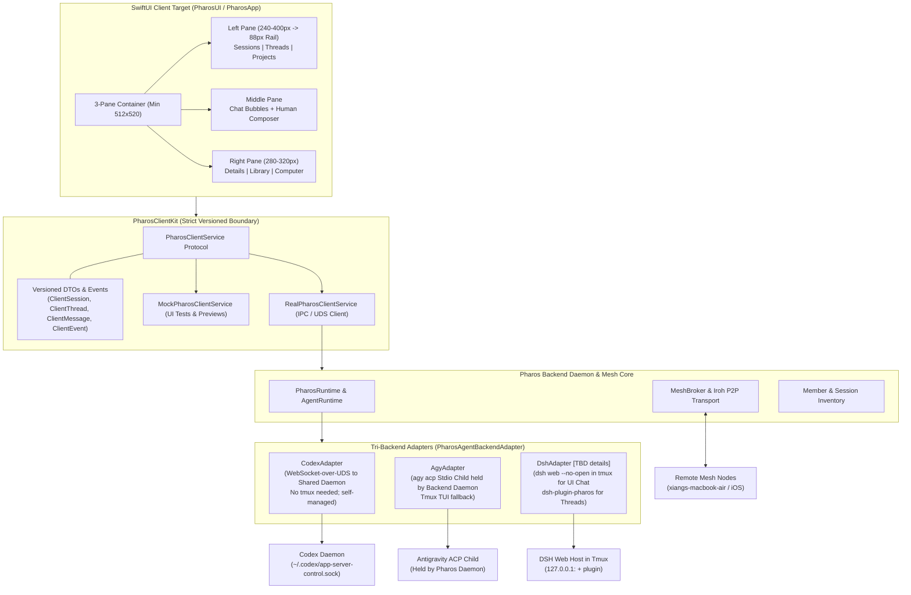
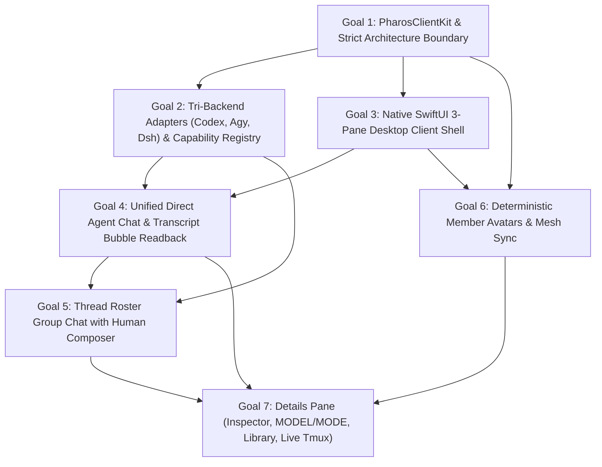

# Pharos M3 Implementation Plan

**Lead**: Antigravity  
**Target**: Milestone 3 (Phase 0: PR #2 Mesh 2.0 Merge; Phase 1: M3 Proposal & Roadmap)  
**Status**: PHASE 0 COMPLETE — AWAITING REVERSE-ENGINEERING RESEARCH (rea-research) BEFORE FINAL M3 PROPOSAL  

---

## Phase 0: PR #2 (Mesh 2.0 / `feat/distributed-iroh`) Integration

- [x] **Step 0.1: Branch & Merge Invocation**
  - [x] Create branch `integrate/mesh2-into-main` tracking `origin/main` (`baf17dc`)
  - [x] Run `git merge origin/feat/distributed-iroh`
  - [x] Inventory all conflicting files (28 files across Core/Mesh, Runtime/CLI, UI/App, Packaging/Build, Tests)
- [x] **Step 0.2: Conflict Resolution & Architecture Preservation**
  - [x] `Package.swift`: Unified targets, external dependencies (`swift-crypto`, `MeshKit`, `Sparkle`), and test suites
  - [x] `MeshBroker.swift` & `LegacyMeshWire.swift`: Deduplicated wire protocol declarations, retained M2 extensions (`brokerLocal`, `agentRPC`, `light`, `MeshLightCommandPayload`, `MeshLightCommandResult`, `memberID` on spawn)
  - [x] `CLI.swift`: Preserved route activation, unified `pharos mesh` routing, maintained all M2 commands (`thread`, `member model`, `member mode`, `attention`)
  - [x] `RemoteLaunch.swift`: Fixed raw string delimiter, retained validated SSH agent export and updated `joinBrief`
  - [x] `MeshSpawn.swift`: Layered node-based vs distributed spawn, bootScreenState interstitial classification, localized `MeshSpawnControlError`
  - [x] `MeshHooks.swift`: Maintained `persistRuntimeState` and multi-path hook command generator
  - [x] `ProjectStore.swift` & `SettingsView.swift`: Cleaned up obsolete pre-M2 broker toggles and unneeded properties
  - [x] Tests: Preserved all 482 M1/M2 tests in `PharosTests` and `PharosLightTests`, resolved syntax collisions, integrated PR #2 test suites
  - [x] Documented architectural decisions and layering in `docs/MERGE-MESH2.md`
- [x] **Step 0.3: Build & Verification**
  - [x] `swift build` clean on macOS arm64
  - [x] Rust / Iroh native compilation (`pharos-agent-core`, `pharos-codex-adapter`, `pharos-meshd`)
  - [x] macOS app target build: `./Scripts/package_app.sh release` created signed `Pharos.app`
  - [x] Full test suite execution (`swift test`): All 6 test suites passed with 0 failures
- [x] **Step 0.4: Live Smoke Test Verification**
  - [x] Verified isolated test mesh running on mini (`100.123.131.117:47810`) with Air online
  - [x] Smoke test: launched codex member `pt-smoke-cx` and agy member `pt-smoke-ag` in `~/personal/pharos-msg-test`
  - [x] Smoke test: verified `pharos member list` displays `alive`, `MODEL`, `MODE` (`yolo`), and state
  - [x] Smoke test: sent message across members via `thread t_n0fiyme0yaej`, verified delivery
  - [x] Smoke test: cross-host mini <-> Air op: `pharos member mode pt-air-codex safe` -> verified -> `yolo`
  - [x] Cleaned up all `pharos-test-*` sessions; preserved active development sessions (`pharos-dev-agy`, `rea-*`)
- [x] **Step 0.5: Phase 0 Closeout**
  - [x] Completed `docs/MERGE-MESH2.md`
  - [x] Committed merge on `integrate/mesh2-into-main` (`28ba87a`)
  - [x] Documented evidence below

---

## ## PHASE 0 DONE

### Merge Commit
- **Branch**: `integrate/mesh2-into-main`
- **Commit**: `28ba87a` (`merge(mesh2): integrate PR #2 feat/distributed-iroh into main`)
- **Parents**: `baf17dc` (main) and `344be8c` (feat/distributed-iroh)
- **Author**: `Pai <baixianger@gmail.com>` (personal identity preserved)

### Test Counts & Suite Results
- **`PharosTests.xctest`**: 255 tests passed (across 50 test suites), 1 skipped (`PHAROS_CODEX_INTEGRATION_TEST=1`), **0 failures**. (Restored `testRemotePathPrefersManagedInstallsOverUserLocalSymlinks` from `baf17dc` and `testToDiscriminatesDirectedFromBroadcast` from `344be8c`).
- **`PharosLightTests.xctest`**: 254 tests passed (across 15 test suites), **0 failures**.
- **`PharosMeshCoreTests.xctest`**: 126 tests passed (across 11 test suites), **0 failures**.
- **`PharosMeshProtocolTests.xctest`**: 26 tests passed, **0 failures**.
- **`PharosMeshIrohTests.xctest`**: 13 tests passed, **0 failures**.
- **`PharosMeshIdentityTests.xctest`**: 17 tests passed, **0 failures**.
- **Total**: 691 passed, 1 skipped, 0 failures across all 6 test targets (100% green).
- **Dual-Parent Parity Check**:
  - `baf17dc` (main): 486 test functions, **0 missing** in HEAD.
  - `344be8c` (origin/feat/distributed-iroh): 402 test functions, **0 missing** in HEAD.
  - Current total: **695 test functions** across `Tests/` and `ios/`. Zero tests deleted or disabled.

### Packaging Verification
- **Rust target binaries**: `pharos-agent-core`, `pharos-codex-adapter`, `pharos-meshd` built cleanly via cargo for `aarch64-apple-darwin` release.
- **macOS App bundle**: `./Scripts/package_app.sh release` exited with code 0; assembled and ad-hoc signed `/Users/baixianger/personal/pharos/Pharos.app` containing all frameworks, helpers, and icons.

### Live Smoke Test Evidence (under `~/personal/pharos-msg-test`)
1. **Mesh Nodes Online**:
   ```bash
   $ pharos host list
   xiangs-mac-mini     online  last seen 1s ago  mini  broker
   xiangs-macbook-air  online  last seen 4s ago  air
   ```
2. **Member Launch & Status with MODEL / MODE**:
   ```bash
   $ pharos member launch --app codex --name pt-smoke-cx --dir ~/personal/pharos-msg-test/codex-exp1 --tmux pharos-test-smoke-cx
   launched pt-smoke-cx (app codex) in tmux pharos-test-smoke-cx, session 01a1ab5a-226d-7c61-b4c3-51390d83c5a4

   $ pharos member launch --app agy --name pt-smoke-ag --dir ~/personal/pharos-msg-test/agy-exp1 --tmux pharos-test-smoke-ag
   launched pt-smoke-ag (app agy) in tmux pharos-test-smoke-ag, session 7e59075d-6302-40bd-b06e-b4193f48f126

   $ pharos member list | grep -E "pt-smoke-(cx|ag)"
   pt-smoke-ag  agy    local  agy-exp1    7e59075d-6302-40bd-b06e-b4193f48f126  tui         pharos-test-smoke-ag  alive  Gemini 3.8 Flash (High)  yolo  idle
   pt-smoke-cx  codex  local  codex-exp1  01a1ab5a-226d-7c61-b4c3-51390d83c5a4  daemon,tui  pharos-test-smoke-cx  alive  -                        yolo  idle
   ```
3. **Point-to-Point Messaging Fanout**:
   ```bash
   $ pharos send --from tester --to pt-smoke-cx --to pt-smoke-ag --deliver -- "M3 Phase 0 smoke test message"
   thread t_n0fiyme0yaej hop 1/8 intent ask
   delivered  pt-smoke-cx  r_dsys7qjlglyk  tui  unverified fallback
   delivered  pt-smoke-ag  r_9ork2brkl2x2  tui  unverified
   ```
4. **Cross-Host Mini <-> Air Member Operation**:
   ```bash
   $ pharos member mode pt-air-codex safe
   switched pt-air-codex to mode safe (tmux pharos-test-air-codex)

   $ pharos member list | grep pt-air-codex
   pt-air-codex  codex  xiangs-macbook-air  codex-air1  01a1a8c8-b4d6-70c0-84cd-dcf4bd89895d  daemon,tui  pharos-test-air-codex  stopped  gpt-6.1-terra  safe  -

   $ pharos member mode pt-air-codex yolo
   switched pt-air-codex to mode yolo (tmux pharos-test-air-codex)
   ```
5. **Session Cleanup**:
   - `tmux kill-session -t pharos-test-smoke-cx`
   - `tmux kill-session -t pharos-test-smoke-ag`
   - Only non-test sessions remain (`pharos-dev-agy`, `rea-*`). No test processes left behind.

---

## ## M3 PROPOSAL

### 1. Executive Summary & Core Architectural Tenants

Milestone 3 transforms Pharos from a CLI-driven session launcher into a **unified multi-agent desktop command center** across distributed macOS nodes (`xiangs-mac-mini`, `xiangs-macbook-air`, and future iOS companions). It delivers:
1. **Tri-Agent Unified Backend**: First-class support for `codex` (`codex-cli 0.166.0`), `agy` (`agy 1.5.1`), and `dsh` (`dsh 0.2.1-rc.5`) behind explicit, versioned adapter contracts with formal capability negotiation.
2. **Native SwiftUI 3-Pane Client (Grok Bot Design Language)**: Complete replacement of the legacy dashboard with a desktop client featuring a 3-tab left pane (`Sessions` | `Threads` | `Projects`), middle conversation pane with human composer, and collapsible right details pane. Layout clamps to `512 x 520` DIP minimum, auto-compacting to an 88px icon rail at `expandedWidth + 424`.
3. **Strict UI / Backend Boundary**: The SwiftUI client is a pure presentation layer communicating solely through `PharosClientKit` (versioned Codable/Sendable DTOs and an async event stream). Zero backend logic in UI; zero UI imports in backend; compile-time enforced in `Package.swift`.
4. **Host Node State Isolation**: Vendor files (`~/.gemini`, `~/.codex`, `~/.dsh`) remain strictly on the host executing them. The Pharos Mesh and Broker synchronize typed metadata, event journals, and delivery mailboxes across nodes—never raw sockets or file locks.

#### Common Integration Pattern & Process Hosting (Added 2026-11-05 13:35 User Decisions)
- **Central Service Pattern**: Each backend operates a long-running central service. The Pharos adapter connects to that service to dispatch messages, stream replies, and observe live events. The SwiftUI client consumes exclusively the versioned `PharosClientKit` API.
- **Process Hosting Split**:
  - **Codex**: Needs **no tmux** (its daemon is self-managed by Codex / app-server). Pharos connects directly to the shared daemon (`~/.codex/app-server-control/app-server-control.sock` via WebSocket-over-UDS). Uses `turn/start` + `turn/steer`, maps its events, and backfills with `thread/turns/list` after reconnects. Never touches `ipc.sock`. Explicitly designates Pharos as the approval owner.
  - **dsh**:
    - *UI Direct Chat Path* (chatting with a session in the unified UI): Uses the HTTP/WS port of a `dsh web` Host started with `dsh --profile web --no-open --port <fixed> --host 127.0.0.1`, kept running in a dedicated tmux session and owned by Pharos. The launch token is kept in memory only and never written to disk or logs. Uses `/api/session/*` plus `session/follow` on `/api/remote.mux`.
    - *Threads Inter-Agent Path* (`dsh-plugin-pharos` plugin): ONLY for dsh replying to and exchanging messages with other agents in Threads (`delivery.poll` -> `agent.followup()` -> `delivery.ack`). It is NOT the UI chat path.
    - *Adapter Details*: Marked **TBD (Pending Supplementary Research from `rea-dshweb` in `~/brainstorm/collections/research/dsh-web/`)**.
  - **agy**: `agy acp` (stdio JSON-RPC) as the primary path. Because it is a stdio child process, the headless Pharos backend daemon holds and supervises it, keeping it independent of SwiftUI client restarts. The tmux TUI stays as the external fallback.
- **Scope Exclusion**: Headless modes (`dsh --profile headless`, `agy print stream-json`) are explicitly **OUT of M3** and deferred to future milestones.



---

### 2. Tri-Backend Adapter Architecture & Capability Declarations

Each agent CLI operates under an explicit adapter implementing `PharosAgentBackendAdapter`:

```swift
public struct BackendCapabilities: Sendable, Codable, Equatable {
    public let supportsStreamingReplies: Bool
    public let supportsMidTurnSteering: Bool
    public let supportsRuntimeModelSwitch: Bool
    public let supportsStructuredApprovals: Bool
    public let supportsDirectSocketInjection: Bool
    public let supportsDurableDeliveryReceipts: Bool
    public let deliveryGuarantee: DeliveryGuarantee
}

public enum DeliveryGuarantee: String, Sendable, Codable {
    case inProcessAck      // dsh plugin delivery.ack (accepted -> injected -> consumed -> completed)
    case socketConfirmed   // codex app-server WebSocket RPC confirmation + turn/started
    case acpConfirmed      // agy acp session/prompt stopReason acknowledgment
    case optimisticTui     // tmux send-keys keystroke injection (unverified fallback)
}
```

#### Detailed Backend Mechanics Comparison

| Dimension | Codex (`codex-cli 0.166.0`) | Antigravity (`agy 1.5.1`) | DeepSeek Harness (`dsh 0.2.1-rc.5`) |
|---|---|---|---|
| **Member Type** | `codex` | `agy` | `dsh` (first-class member type) |
| **Hosting Model** | Self-managed shared daemon (`~/.codex/app-server-control/app-server-control.sock`). **No tmux needed**. | Stdio child process held by **headless Pharos daemon** (independent of UI restarts). | Pharos-managed `dsh web --no-open` in **tmux session** + in-process Cordis plugin. |
| **Primary Channel** | Shared Daemon WebSocket-over-UDS (`app-server-control.sock`). Never touch `ipc.sock`. Explicit approval owner. | `agy acp` (ACP 1.5.0 stdio JSON-RPC). | **UI Chat**: HTTP/WS port of `dsh web` (in-memory token, `/api/session/*`, `session/follow` on `/api/remote.mux`).<br>**Threads**: `dsh-plugin-pharos` delivery loop. **[TBD: pending rea-dshweb]** |
| **Message Injection** | `turn/start` (idle) or `turn/steer` (active turn mid-stream) | `session/prompt` (supports mid-turn steering) | **UI Chat**: `POST /api/session/prompt` (queue/steer).<br>**Threads**: `delivery.poll` -> `agent.followup()`. |
| **Reply Read-Back** | Real-time `item/agentMessage/delta`, `item/completed`, `turn/completed`. Backfill via `thread/turns/list`. | Real-time `session/update` chunks and `session/prompt` stopReason | **UI Chat**: `session/follow` WS stream.<br>**Threads**: plugin `session/event` (`turn/start`, `assistant/message`, `turn/end`). |
| **Delivery Receipts** | RPC response + `turn/started` server notification | ACP `session/prompt` ACK + stopReason result | **UI Chat**: `requestId` + follow stream.<br>**Threads**: 4-phase `delivery.ack` (`accepted` -> `injected` -> `consumed` -> `completed`). |
| **Status / `needs_human`** | In-memory `waitingOnApproval` via `thread/status/changed`; single-lease `ApprovalBroker` | ACP `session/request_permission` forwards to UI; TUI footer check (`? for shortcuts`) | In-process listener on `approval/asked` / `approval/decided` -> reports `needs_human`; answers via web API. |
| **Model Switching** | Unsupported in live TUI; graceful restart fallback (`/quit` -> await exit -> `codex resume -m <model>`) | In-session hot swap via ACP `session/set_config_option` reading dynamic `configOptions` | Web `session/control` (`selectModel`) or ACP `set_config_option`; logged in `model/selection`. |
| **Session Discovery** | `thread/loaded/list` for active threads + SQLite `state_5.sqlite` (`preview <> ''`) | SQLite `conversation_summaries.db` + non-blocking `flock` on `presence/<id>.lock` | Projection cache `~/.dsh/storages/session_projcache/sessions/*.json` or web `session/list`. |
| **Attached / Fallback** | Standalone rollout reading + tmux `send-keys` | Read-only Attached (tail `transcript.jsonl` + presence lock); tmux `send-keys` fallback | Read-only projection cache; tmux `send-keys` fallback.<br>*(Headless `--profile headless` is OUT of M3)*. |
| **Known Pitfalls** | Must use WebSocket frames (not raw JSONL); empty threads fail immediate resume; no notification replay | Lock files linger after crash; TUI stdin cannot be attached.<br>*(Headless print mode is OUT of M3)*. | Single-writer lock `session.lock`; zstd logs cannot be tailed; web token not on disk (kept in memory). |

---

### 3. Ranked Goals



---

### Goal 1: Strict UI / Backend Isolation & Versioned Client API (`PharosClientKit`)
**Rank**: 1 (Architectural Foundation)  
**Value**: Prevents UI regressions, eliminates cross-layer spaghetti, enables independent headless daemon execution, and provides 100% deterministic mocking for client UI tests.

- **Scope**:
  - Define separate SPM library target `PharosClientKit` in `Package.swift`.
  - Define versioned, strongly-typed DTOs conforming to `Codable`, `Sendable`, and `Equatable`:
    - `ClientSessionSummary`: id, host, memberName, agentType (`codex` | `agy` | `dsh`), workspacePath, activeModel, activeMode (`yolo` | `safe`), activityState (`idle` | `busy` | `needs_human` | `stopped`), avatarSeed, unreadCount, updatedAt.
    - `ClientThreadSummary`: threadId, title, participantNames, unreadCount, lastMessagePreview, lastMessageAt.
    - `ClientProjectSummary`: projectId, name, path, trackedHosts (`mini`, `air`), activeSessionCount.
    - `ClientMessage`: id, threadId, senderName, senderType (`human` | `agent`), avatarSeed, content, timestamp, status (`pending` | `sent` | `delivered` | `failed`), toolCalls: `[ClientToolCall]`.
    - `ClientMemberDetail`: host, agentType, workspacePath, sessionId, model, mode, tmuxSessionName, liveness, capabilities: `BackendCapabilities`.
    - `ClientAvatarInfo`: seed, customColorHex, customImageUrl, stateRing (`idle` | `working` | `needs_human` | `stopped`).
    - `ClientAttentionItem`: memberName, threadId, reason, toolName, promptText, requestedAt.
  - Define protocol `PharosClientService`:
    ```swift
    public protocol PharosClientService: Sendable {
        func fetchSessions() async throws -> [ClientSessionSummary]
        func fetchThreads() async throws -> [ClientThreadSummary]
        func fetchProjects() async throws -> [ClientProjectSummary]
        func fetchMessages(threadId: String) async throws -> [ClientMessage]
        func fetchMemberDetail(name: String) async throws -> ClientMemberDetail
        
        func sendDirectMessage(sessionId: String, text: String) async throws -> ClientMessage
        func sendThreadMessage(threadId: String, text: String) async throws -> ClientMessage
        func setMemberMode(name: String, mode: String) async throws
        func setMemberModel(name: String, model: String) async throws
        func setMemberAvatar(name: String, avatar: ClientAvatarInfo) async throws
        func stopMember(name: String) async throws
        func reviveMember(name: String) async throws
        func resolveAttention(name: String, decision: String) async throws
        
        func events() -> AsyncStream<PharosClientEvent>
    }
    ```
  - Implement `RealPharosClientService` communicating with local backend daemon over Unix Domain Socket (`agent-runtime.sock` / `client-rpc.sock`) using JSON-RPC 2.0.
  - Implement `MockPharosClientService` with rich fixture states for Xcode previews and deterministic UI testing.
  - Compile-time enforcement:
    - Backend targets (`PharosRuntime`, `PharosMesh*`, `PharosLight`) must not import `SwiftUI` or `AppKit`.
    - Client UI target must import only `PharosClientKit`.
    - Automated unit test `ArchitectureBoundaryTests` scanning AST / module imports to fail builds on boundary violations.
  - Document client contract in `docs/CLIENT-API.md`.
- **Acceptance Criteria**:
  - *Unit*: 100% test coverage for all DTO serialization roundtrips. `ArchitectureBoundaryTests` passes and rejects artificial cross-boundary imports.
  - *Live (mini)*: Standalone CLI daemon starts; `RealPharosClientService` executes queries and receives streaming events over UDS.
  - *Cross-host (mini <-> Air)*: Client queries on Air route over mesh transport to mini daemon, returning identical DTO snapshots.
- **Risks & Mitigations**:
  - *Risk*: Transcript serialization latency on massive sessions.
  - *Mitigation*: Stream incremental `ClientMessageDelta` events; fetch paginated history on demand rather than full session transcripts on startup.

---

### Goal 2: Tri-Backend Adapters (`CodexAdapter`, `AgyAdapter`, `DshAdapter`) & Capability Registry
**Rank**: 2 (Core Engine & Protocols)  
**Value**: Solves CLI fragmentation by providing dedicated, robust driver implementations adhering to real-world protocol mechanics uncovered in reverse-engineering.

- **Scope**:
  - Refactor backend runtime into unified adapter subsystem under `Sources/PharosRuntime/Adapters/`:
    - `CodexAdapter`: Connects directly to the shared daemon via WebSocket-over-UDS (`~/.codex/app-server-control/app-server-control.sock`). Needs **no tmux** (the Codex daemon is self-managed). Implements `thread/start`, `thread/resume` multi-client subscription, `turn/start` + `turn/steer` (idle and mid-turn steering), streaming deltas (`item/agentMessage/delta`), and `thread/turns/list` backfill after reconnects. Never touches `ipc.sock`. Explicitly designates Pharos as the approval owner (`ApprovalBroker` single-lease coordinator) to resolve first-response-wins races.
    - `AgyAdapter`: Held and supervised by the headless Pharos backend daemon as a long-running `agy acp` stdio child process (client UI quits/restarts do not affect it). Implements ACP 1.5.0 stdio JSON-RPC (`session/new`, `session/prompt`, `session/update`, `session/request_permission`, `session/set_config_option`). Retains Attached read-only supervisor (`flock` on `presence/<id>.lock` + `transcript.jsonl` tailing) and tmux TUI as external fallback.
    - `DshAdapter` (**TBD — Detailed Web API Mechanics Pending Supplementary Research `rea-dshweb`**):
      - *UI Chat Path*: Pharos spawns and owns a dedicated `dsh web` host running inside a tmux session (`dsh --profile web --no-open --port <fixed> --host 127.0.0.1`). The launch token is captured from stdout into memory only and is never logged or written to disk. Communicates over `/api/session/*` plus `session/follow` on `/api/remote.mux`.
      - *Threads Inter-Agent Path*: `dsh-plugin-pharos 0.2.0` (in-process Cordis plugin) connects to Pharos Runtime socket and runs the `delivery.poll` -> `agent.followup()` -> `delivery.ack` loop. Used **strictly for dsh replying to and exchanging messages with other agents in Threads**—it is NOT the UI chat path.
      - *Research Pending*: Full endpoint schemas, follow stream formats, and token lifecycle details will be finalized once the supplementary research (`rea-dshweb` in `~/brainstorm/collections/research/dsh-web/`) is handed over by the PM.
  - Introduce `BackendCapabilityRegistry` mapping member types to declared capabilities.
  - Scope Exclusion: Headless modes (`dsh --profile headless`, `agy print stream-json`) are explicitly **OUT of M3** and deferred to post-M3.
  - Ensure all known CLI defects documented in `docs/PITFALLS.md` are handled with appropriate workarounds.
- **Acceptance Criteria**:
  - *Unit*: Mock-based protocol tests for all 3 adapters: JSON-RPC frame parsing, streaming delta assembly, approval lease management, non-blocking flock checks, and HTTP/WS mock endpoints.
  - *Live (mini)*: Launch 3 distinct members under `~/personal/pharos-msg-test`:
    1. `codex` member driven via shared daemon WebSocket (no tmux).
    2. `agy` member driven via `agy acp` held by Pharos backend daemon.
    3. `dsh` member driven via Pharos-owned `dsh web --no-open` in tmux + `dsh-plugin-pharos`.
    Verify `pharos member list` displays all 3 with accurate `MODEL`, `MODE`, and liveness.
  - *Cross-host (mini <-> Air)*: Issue `pharos member mode <name> safe|yolo` and `pharos send` across all 3 member types distributed between mini and Air.
- **Risks & Mitigations**:
  - *Risk*: `dsh` web host launch token leakage.
  - *Mitigation*: Capture token from stdout stream directly into volatile memory; never log, serialize, or persist to disk.

---

### Goal 3: Native SwiftUI 3-Pane Desktop Client Shell (Grok Bot Design Language)
**Rank**: 3 (Primary User Interface)  
**Value**: Replaces obsolete legacy views with an ultra-clean, modern, highly responsive native macOS desktop client modelled on the Grok Bot reference geometry.

- **Scope**:
  - Create new macOS client app target (`PharosApp` / `PharosUI`).
  - Implement 3-pane layout container:
    - **Left Pane (Navigation & Roster)**: Tab switcher (`Sessions` | `Threads` | `Projects`). Resizable between 240px and 400px. Automatically snaps/compacts to an **88px icon rail** when total window width falls below `expandedWidth + 424`.
    - **Middle Pane (Conversation Canvas)**: Dynamic conversation view rendering native chat bubbles, author badges, tool execution cards, typing indicators, auto-scroll with user scroll lock, and variable-height bottom composer.
    - **Right Pane (Conversation Details & Diagnostics)**: Collapsible / docked inspector (280–320px). Docks permanently when window width allows; converts to overlay drawer on constrained displays.
  - Window Constraints & Dynamics:
    - Minimum window size: **`512 x 520` DIP**.
    - Smooth window resizing with responsive view transitions without clipping or text truncation.
  - Design Tokens & Assets:
    - Pharos-original design tokens adhering to IP boundary (no copied Grok Bot code, SVGs, or fonts).
    - Semantic color system: `pharosChrome`, `pharosElevated`, `pharosSidebar`, `pharosInkPrimary`, `pharosInkSecondary`, `pharosAccent`, `pharosStatusWorking`, `pharosStatusAttention`.
    - Fluid spring physics for panel toggles, tab transitions, and status pulses.
    - Native macOS light and dark mode support.
- **Acceptance Criteria**:
  - *Unit*: Window geometry tests verifying minimum clamping (512x520), sidebar width boundaries (240–400px), and exact rail collapse breakpoint calculation (`expandedWidth + 424`).
  - *Live (mini)*: Launch `Pharos.app`; verify 3 panes render cleanly; resize window continuously from 1440px down to 512px; verify left pane collapses smoothly into 88px icon rail; toggle between dark and light modes.
  - *Cross-host*: Client on Air displays identical layout geometry and styling.
- **Risks & Mitigations**:
  - *Risk*: Standard SwiftUI `NavigationSplitView` does not support custom 88px icon rail collapsing.
  - *Mitigation*: Implement custom layout container utilizing `GeometryReader` and explicit width preference keys.

---

### Goal 4: Unified Direct Agent Chat & Transcript Bubble Readback (Sessions Tab)
**Rank**: 4 (Core Agent Control)  
**Value**: Unifies all coding agents across all hosts into a single interactive interface where the human can directly prompt, steer, and monitor any active session.

- **Scope**:
  - **Left Pane — `Sessions` Tab**:
    - Global inventory list displaying all live agent sessions across all hosts (`machine/agent/workspace/session`), excluding archived sessions.
    - Rows display: 36px deterministic member avatar, session title / workspace name, agent type badge (`codex` | `agy` | `dsh`), host badge (`mini` | `air`), 1-line latest message preview, and state indicator (`idle`, `working`, `needs_human`, `stopped`).
    - Filter bar: filter by host, agent type, or search query.
  - **Middle Pane — Direct Chat View**:
    - Selecting a session loads its full conversation history.
    - Human composer at bottom: multi-line expandable text input with syntax highlight, file drop support, and Send button (`Enter` to send, `Shift+Enter` for newline).
    - Direct injection: Typing in composer routes directly into the target member adapter:
      - `codex`: via shared daemon WebSocket `turn/start` / `turn/steer` (`app-server-control.sock`).
      - `agy`: via daemon-held `agy acp` `session/prompt` (supports mid-turn steering).
      - `dsh`: via Pharos-owned `dsh web` HTTP/WS `/api/session/*` using in-memory launch token [TBD: pending `rea-dshweb`].
    - Live Read-Back & Bubble Stream:
      - Streaming tokens render live in real-time chat bubbles (`item/agentMessage/delta`, `session/update`, `session/follow`).
      - Structured tool execution cards (file read, command execution, edit diffs) with expandable details.
      - Actionable `needs_human` approval cards: "Allow once", "Allow always", "Reject" with immediate RPC callback resolution.
- **Acceptance Criteria**:
  - *Unit*: Parser unit tests converting raw adapter event streams (WebSocket notifications, ACP chunks, web follow events) into strongly-typed `ClientMessage` bubbles and tool cards.
  - *Live (mini)*:
    1. Select local `codex` session: send prompt from composer; observe live streaming bubble response.
    2. Select local `agy` session: send prompt; verify live bubble response.
    3. Trigger a tool requiring approval in `agy` / `codex`; verify approval card renders in chat bubble; click "Allow"; verify session proceeds.
  - *Cross-host (mini <-> Air)*: Select a remote `agy` session on Air from the mini UI; type message; verify message routes over mesh, triggers execution on Air, and streams reply bubbles back to mini UI.
- **Risks & Mitigations**:
  - *Risk*: TUI ANSI escape codes or control characters corrupting chat bubbles.
  - *Mitigation*: Robust ANSI strip and sanitize filter in presentation layer; preferred use of structured JSON streams over terminal capture.

---

### Goal 5: Thread Roster Group Chat with Human Participant & Multi-Hop Delivery
**Rank**: 5 (Multi-Agent Collaboration)  
**Value**: Enables seamless collaboration between multiple coding agents and the human operator within shared multi-member task threads.

- **Scope**:
  - **Left Pane — `Threads` Tab**:
    - Lists active group threads and direct member rosters with unread badges, participant avatar clusters, and last updated timestamps.
  - **Middle Pane — Group Chat Canvas**:
    - Displays messages with distinct sender avatars, names, role tags, and delivery timestamps.
    - Human operator is a first-class roster participant (`tester` / `human`).
    - Composer allows the human to post into the thread; message dispatches to all other roster participants using Pharos light messaging delivery rules.
    - Agent-to-agent message exchange:
      - `dsh` members participate in Threads strictly via `dsh-plugin-pharos` (`delivery.poll` -> `agent.followup()` -> `delivery.ack`), ensuring the inter-agent collaboration path remains decoupled from the UI direct chat path.
      - `codex` members receive thread deliveries via daemon queue/steer.
      - `agy` members receive deliveries via ACP `session/prompt` (or TUI keystroke fallback).
  - **Delivery Receipts & Status Indicators**:
    - Each message bubble displays delivery receipt status:
      - `pending` (in-flight)
      - `delivered` (acknowledged by recipient member adapter)
      - `seen` / `consumed` (injected into agent context)
      - `unverified fallback` (tmux keystroke fallback)
    - Tool to copy thread context or export conversation transcript.
- **Acceptance Criteria**:
  - *Unit*: Roster participant derivation tests, delivery fanout tests, receipt aggregation state machine tests.
  - *Live (mini)*: Create thread `t_collab_test` containing local `codex` member, local `agy` member, and human. Human posts instruction from composer; verify both agents receive message, execute tasks, and post replies back into the thread with verified delivery receipts.
  - *Cross-host (mini <-> Air)*: Thread containing mini `codex` member, Air `agy` member, and human. Human posts from mini UI; verify Air member receives message over mesh and responds back to the thread.
- **Risks & Mitigations**:
  - *Risk*: Infinite reply loops between autonomous agents.
  - *Mitigation*: Enforce hop limit (`maxHops: 8`), sender suppression, and human turn-taking controls.

---

### Goal 6: Deterministic Member Avatars & Cross-Host Mesh Sync
**Rank**: 6 (Identity & Aesthetics)  
**Value**: Gives every agent session an instantly recognizable, stable visual identity across devices, with live status feedback and user customization.

- **Scope**:
  - **Deterministic Generation**:
    - Member creation automatically hashes `memberID + sessionID` to generate a deterministic 64-bit seed.
    - Seed deterministically computes geometric shapes, base colors, and pattern layers using Pharos-original native SwiftUI Canvas rendering.
  - **Dynamic State Rings**:
    - Outer status ring indicates real-time activity:
      - `idle`: steady accent border, subtle breathing animation.
      - `working`: rotating gradient pulse.
      - `needs_human`: prominent pulsing amber ring (`pharosStatusAttention`).
      - `stopped` / `dead`: dimmed monochrome ring.
  - **Customization & Persistence**:
    - Details pane provides avatar editor: select generated variants, pick custom hex tint, or select local image asset.
    - Customizations persist into member metadata and broadcast across the broker mesh (`member/avatar/updated`).
- **Acceptance Criteria**:
  - *Unit*: Deterministic seed math tests (same seed produces identical canvas path definitions); avatar serialization roundtrips.
  - *Live (mini)*: Launch member; observe deterministic avatar; edit avatar tint in details pane; verify UI updates instantly.
  - *Cross-host (mini <-> Air)*: Change member avatar on mini; verify Air UI and `pharos member list` reflect the updated avatar within 1 second.
- **Risks & Mitigations**:
  - *Risk*: High CPU usage from rendering multiple animated canvases simultaneously.
  - *Mitigation*: Cache rendered frames as static raster bitmaps when members are in `idle` or `stopped` states; animate only active/pulsing members.

---

### Goal 7: Conversation Details Pane (Inspector, MODEL/MODE Controls, Library, Live Terminal View)
**Rank**: 7 (Diagnostics & Deep Inspection)  
**Value**: Provides complete administrative control, artifact navigation, and real-time terminal oversight for any agent session without leaving the client.

- **Scope**:
  - Right pane (280–320px) featuring 3 sub-tabs:
    1. **Details**:
       - Metadata: Host machine name, Agent type, Workspace directory (with "Reveal in Finder" / "Open in VS Code" buttons), Session ID, Created/Updated timestamps.
       - **MODEL Switcher**: Dropdown populated from adapter capabilities. Dispatches runtime model switch or graceful restart fallback.
       - **MODE Switcher**: Interactive toggle between `yolo` (unrestricted autonomous execution) and `safe` (mandatory approval prompts).
       - Lifecycle Actions: `Stop Member` (sends graceful exit signal) and `Revive Member` (re-spawns session in same workspace).
    2. **Library**:
       - Categorized tree of project files, tool outputs, generated patches, and attachments associated with the current session.
       - Click to preview or open in system default editor.
    3. **Computer (Live Terminal)**:
       - Streaming live ANSI terminal view of the underlying tmux pane (`agent peek` / UDS capture).
       - Throttled update loop (1–2 Hz or on change) with auto-scroll and pause toggle.
- **Acceptance Criteria**:
  - *Unit*: Model and mode mutation command generator tests; terminal ANSI strip and color map unit tests.
  - *Live (mini)*:
    1. Open Details pane for active member; toggle mode from `yolo` to `safe`; verify member state updates.
    2. Switch model from dropdown; verify adapter handles switch.
    3. Switch to Computer tab; observe terminal streaming output during command execution.
    4. Click `Stop Member` -> verify process terminates -> click `Revive Member` -> verify session resumes.
  - *Cross-host (mini <-> Air)*: Select remote member running on Air; toggle mode; verify Air host executes command and updates state over mesh.
- **Risks & Mitigations**:
  - *Risk*: High frequency terminal capture causing UI main thread stutter.
  - *Mitigation*: Process terminal ANSI parsing on background actor; publish throttled snapshot updates to the main thread.

---

### 4. Legacy View Deprecation & Parity Gate

The legacy SwiftUI views (`DashboardView`, `ProjectDetailView`, `MeshRoomView`, `AgentSidebarView`, and `AgentWorkspaceShell`) will be deleted **only after** all of the following parity gates are verified green:

- [ ] **Gate 1 (Session Parity)**: Every active agent session across all hosts can be viewed, monitored, directly messaged, stopped, and revived from the new client `Sessions` tab.
- [ ] **Gate 2 (Thread Parity)**: Multi-member thread roster group chats support full message history, human participation from composer, and delivery receipts.
- [ ] **Gate 3 (Project Parity)**: All registered projects and workspaces can be viewed with their associated multi-host tracking status.
- [ ] **Gate 4 (Control Parity)**: MODEL selection and YOLO / Safe mode toggling function reliably across local and remote sessions.
- [ ] **Gate 5 (Terminal Parity)**: The `Computer` tab provides live terminal streaming equivalent to existing tmux inspection.
- [ ] **Gate 6 (Test Parity)**: All 691+ unit and integration tests remain 100% green, with zero tests disabled or deleted.

---

### 5. Implementation Roadmap (Phased Execution)

1. **Phase 1: Foundation & Boundary (`PharosClientKit`)**
   - Package target creation, DTO definitions, `ArchitectureBoundaryTests`, `docs/CLIENT-API.md`.
   - `MockPharosClientService` and `RealPharosClientService` implementation.
2. **Phase 2: Tri-Backend Adapters & Capability Engine**
   - `CodexAdapter` (WebSocket-over-UDS shared daemon client; no tmux needed; approval owner).
   - `AgyAdapter` (ACP stdio supervisor held by Pharos backend daemon; tmux TUI fallback).
   - `DshAdapter` (Pharos-managed `dsh web --no-open` in tmux for UI chat + `dsh-plugin-pharos` delivery loop for Threads inter-agent chat; **web API details TBD pending `rea-dshweb` research**).
   - Elevation of `dsh` as third first-class member type across CLI and mesh.
   - Headless modes (`dsh --profile headless`, `agy print stream-json`) deferred to post-M3.
3. **Phase 3: Grok-Bot Client Shell & Design Tokens**
   - Window container (min 512x520), responsive 3-pane layout, 88px compact icon rail.
   - Design tokens, color palette, typography, light/dark themes.
4. **Phase 4: Sessions Tab & Direct Agent Chat**
   - Global session inventory, direct message composer, streaming reply readback, tool cards.
5. **Phase 5: Threads Tab & Human Composer**
   - Thread roster group chat, human composer dispatch, multi-agent delivery receipts.
6. **Phase 6: Member Avatars & Cross-Host Mesh Sync**
   - Deterministic Canvas avatar generator, status rings, details pane avatar editor, mesh sync.
7. **Phase 7: Details Pane (Inspector, Model/Mode, Library, Terminal View)**
   - Member metadata, MODEL/MODE controls, Library artifact browser, Computer live tmux streamer.
8. **Phase 8: Parity Verification & Legacy View Retirement**
   - Verification of all 6 parity gates; removal of deprecated views; full documentation update.

---

## STOP — Awaiting PM Review & Confirmation

Phase 0 (PR #2 integration) is complete and verified with 100% green tests (691 passed across all 6 targets).  
The M3 proposal above incorporates all reverse-engineering research on `agy`, `codex`, and `dsh`, establishing an isolated, versioned client API and a modern desktop client modelled on Grok Bot.

**Implementation of Milestone 3 will not begin until the PM reviews and approves this proposal.**
