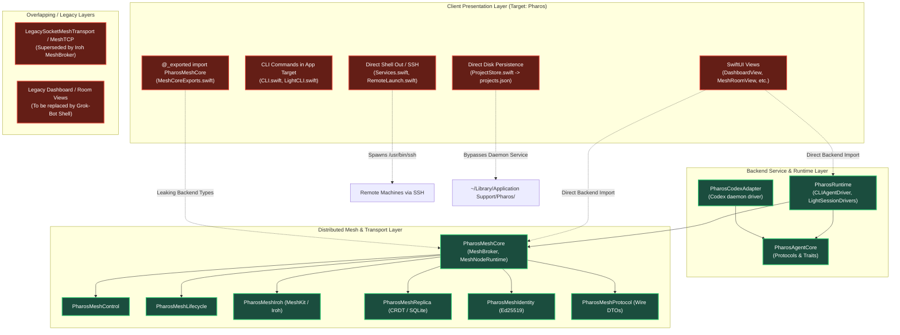

# Pharos Architecture Audit (main @ 627fc46)

---
summary: Architecture audit of Pharos at main 627fc46 following the merge of Mesh 2.0 (PR #4). Maps actual target dependencies and imports against core architectural invariants. Catalogs all violations with file:line, severity, and concrete fixes. Details duplicate/dead layers and defines the automated layering enforcement plan for Milestone 3 companion to RFC-006.
---

- Authority & Design Reference: [RFC-006: Unified Client and Backend Integration](RFC-006-UNIFIED-CLIENT-AND-BACKEND-INTEGRATION.md)

## 1. Architectural Invariants & Design Principles

The Pharos architecture is guided by six core invariants established in `.agy-tasks/GOAL.md` and [RFC-006](RFC-006-UNIFIED-CLIENT-AND-BACKEND-INTEGRATION.md):

1. **Strict Client / Backend Boundary (`PharosClientKit`)**: The SwiftUI client is a pure presentation layer. It must contain NO delivery, tmux, CLI, SSH, mesh, broker, transcript-parsing, or persistence logic.
2. **One Versioned Client API**: All client <-> backend communication occurs exclusively through strongly-typed, `Codable`/`Sendable` DTOs and async event streams exposed by `PharosClientKit` (backed by a local UDS JSON-RPC daemon).
3. **Headless Backend Autonomy**: Backend modules (`PharosRuntime`, `PharosMesh*`, `PharosAgentCore`, adapters) must never import `SwiftUI` or `AppKit`. The backend must be 100% testable and runnable headless via CLI and daemon without the macOS app process running.
4. **Host Node State Isolation**: Vendor state (`~/.gemini`, `~/.codex`, `~/.dsh`) remains strictly on the executing host. Cross-machine communication routes through the remote host's Pharos node over Mesh/Broker—never raw sockets or file locks across machines.
5. **Zero UI Shelling Out**: The client UI must never invoke `Process()`, shell out to `/bin/sh`, run `/usr/bin/ssh`, or manipulate tmux panes directly. All actions are dispatched as high-level requests to the backend service.
6. **Two Interaction Modes Only (Session vs Thread per RFC-006 §1 & GOAL.md 15:02)**:
   - **Session (1:1 Direct Chat over Mesh)**: In the generic Session view, the human talks directly to one agent session over the mesh. The client dispatches requests to the host node owning the session; that node drives the vendor service locally (Codex daemon UDS, dsh web Host HTTP/WS, agy ACP stdio) and streams canonical events back over the mesh to the client (uniform path for local and remote hosts). Uses the Rich Canonical Message Model (`docs/MESSAGE-MODEL.md`).
   - **Thread (Multi-Agent Group Conversation)**: The human posts in a group conversation and addresses specific agents over the durable mesh mailbox (RFC-005 point-to-point delivery). The human is an **implicit, invisible participant of every thread** by default (never listed in the roster, can always send, receives all messages and replies, and is the default reply target). Threads use lightweight plain chat bubbles (`ClientThreadMessage`), where agents emit only their final plain text reply upon turn finish with zero intermediate thinking, tool, or step events.

---

## 2. Current Layering Diagram (main @ 627fc46)

The diagram below maps the current target dependency graph in `Package.swift` and highlights architectural violations:



---

## 3. Comprehensive Violation Catalog

Each architectural boundary violation in `main` (commit `627fc46`) is itemized below with exact source locations, severity rating, and concrete remediation steps:

| Violation ID | Category | Source Location | Severity | Description | Concrete M3 Remediation |
|---|---|---|---|---|---|
| **VIO-01** | Boundary Leak | `Sources/Pharos/MeshCoreExports.swift:1` | **CRITICAL** | `@_exported import PharosMeshCore` re-exports the entire backend mesh into the presentation module. | **Delete file**. Client must only import `PharosClientKit`. |
| **VIO-02** | UI Shelling Out | `Sources/Pharos/Services.swift:16, 51` | **CRITICAL** | `Shell.run` invokes `Process()` directly inside the client target to run git and system binaries. | Relocate `Shell` to backend runtime; client triggers Git operations via daemon client service. |
| **VIO-03** | UI Shelling Out | `Sources/Pharos/RemoteLaunch.swift:168, 197, 324` | **CRITICAL** | Runs `Process()` for `/usr/bin/ssh` and tmux commands directly from UI triggers. | Move all remote machine spawning to `PharosRuntime` daemon over MeshBroker. UI issues high-level `launchSession`. |
| **VIO-04** | UI Backend Import | `Sources/Pharos/DashboardView.swift:1` | **HIGH** | `import PharosMeshControl` directly in legacy dashboard view. | Deprecate view; route all node queries through `PharosClientService`. |
| **VIO-05** | UI Backend Import | `Sources/Pharos/AgentSessionsView.swift:2-3` | **HIGH** | `import PharosMeshCore` and `import PharosRuntime` directly in sessions list view. | Refactor view to consume `[ClientSessionSummary]` from `PharosClientKit`. |
| **VIO-06** | UI Backend Import | `Sources/Pharos/ProjectStore.swift:4-5` | **HIGH** | `import PharosRuntime` and `import PharosMeshCore` to manage project list and sync. | Move project tracking and registry synchronization to backend daemon. |
| **VIO-07** | UI Direct Persistence | `Sources/Pharos/ProjectStore.swift:34, 65` | **HIGH** | Direct disk I/O to `~/Library/Application Support/Pharos/projects.json`. | Daemon owns `projects.json`. Client accesses projects via async RPC `fetchProjects()`. |
| **VIO-08** | Packaging Colocation | `Sources/Pharos/CLI.swift:1-50` | **HIGH** | CLI router (`pharos ...`) is bundled inside the macOS app target `Pharos`. | Move CLI entry points to `Sources/PharosMesh/` (or dedicated executable target `pharos-cli`). |
| **VIO-09** | Packaging Colocation | `Sources/Pharos/LightCLI.swift:1-40` | **MEDIUM** | Light messaging CLI router compiled into GUI application target. | Relocate to headless CLI target. |
| **VIO-10** | UI Backend Import | `Sources/Pharos/MeshSetupView.swift:2-3` | **MEDIUM** | Imports `PharosMeshCore` and `PharosMeshLifecycle` directly in setup view. | Setup state machine belongs in backend; UI renders declarative onboarding states. |
| **VIO-11** | UI Backend Import | `Sources/Pharos/BrokerSetupOnboardingView.swift:1-2` | **MEDIUM** | Imports `PharosMeshCore` and `PharosRuntime` directly. | Convert to presentation component consuming onboarding DTOs. |
| **VIO-12** | UI Backend Import | `Sources/Pharos/PairDeviceSheet.swift:4` | **MEDIUM** | Imports `PharosMeshCore` to generate pairing QR codes and invitations. | Pairing token generation moved to backend; UI receives typed invite payload. |
| **VIO-13** | UI Backend Import | `Sources/Pharos/AgentSidebarView.swift:2` | **MEDIUM** | Imports `PharosMeshCore` to inspect mesh node inventory directly. | View replaced by Grok Bot Left Pane observing `PharosClientService.events()`. |
| **VIO-14** | Transport Duplication | `Sources/PharosMeshCore/LegacySocketMeshTransport.swift` | **MEDIUM** | Legacy raw TCP socket mesh transport coexists with Iroh P2P transport. | Retire legacy TCP transport; standardize on `MeshBroker` (Iroh P2P). |
| **VIO-15** | Transport Duplication | `Sources/PharosMeshCore/MeshTCP.swift` | **LOW** | Obsolete TCP helpers superseded by Iroh connection protocol. | Remove once legacy migration completes. |

---

## 4. Verification of Headless Backend Invariant

We audited all backend targets to verify compliance with Invariant 3 (**Backend modules never import SwiftUI/AppKit**):

```bash
grep -rn "import SwiftUI" Sources/PharosMesh* Sources/PharosAgentCore Sources/PharosRuntime Sources/PharosCodexAdapter Sources/PharosMesh
grep -rn "import AppKit" Sources/PharosMesh* Sources/PharosAgentCore Sources/PharosRuntime Sources/PharosCodexAdapter Sources/PharosMesh
```

**Audit Result**: **100% CLEAN (Zero backend violations)**.
All 32 `import SwiftUI` and 18 `import AppKit` occurrences across `Sources/` are confined strictly to `Sources/Pharos/`. The backend runtime and mesh modules are completely decoupled from Apple GUI frameworks and run cleanly in headless mode.

---

## 5. Automated Layering Enforcement Plan

To ensure that the architecture does not regress during Milestone 3 implementation, Pharos incorporates automated layering enforcement into the build and test pipeline.

### 5.1 Unit Test Gate: `ArchitectureBoundaryTests`
An automated test suite in `Tests/PharosTests/ArchitectureBoundaryTests.swift` enforces layering across the repository:
1. **No SwiftUI / AppKit in Backend**: Scans all Swift source files across all 11 backend directories outside `Sources/Pharos/` (`Sources/PharosMesh*`, `Sources/PharosAgentCore`, `Sources/PharosRuntime`, `Sources/PharosCodexAdapter`, etc.). Asserts 0 occurrences of `import SwiftUI`, `import AppKit`, or `import Cocoa`. (Verified passing at 100% clean).
2. **No `Process()` in Presentation**: Scans client presentation source files to ensure no UI code invokes `Process()`, `Shell.run`, or `NSTask`.
3. **No Direct Backend Internal Imports in Client**: Once `PharosClientKit` is introduced, verifies that client files import ONLY `PharosClientKit`, `SwiftUI`, and `Foundation`.

### 5.2 Build Boundary Enforcement in `Package.swift`
In Milestone 3 Phase 1:
- `PharosClientKit` will be declared as a client-facing library target depending only on `Foundation`.
- The client app target (`Pharos` / `PharosApp`) will depend **strictly on `PharosClientKit`**, removing all dependencies on `PharosMeshCore` and `PharosRuntime`.
- Attempting to import backend modules in client views will result in an immediate SwiftPM compile-time build failure.

---

## 6. Ranked Remediation Action Items for M3

The remediation plan is sequenced to eliminate critical boundary breaches first, followed by clean view replacement:

1. **Rank 1 (Critical): Introduce `PharosClientKit` & Enforce Target Boundaries** (M3 Goal 1)
   - Define versioned DTOs, `CanonicalTurn`, `CanonicalBlock`, and `PharosClientService`.
   - Remove `MeshCoreExports.swift`.
   - Implement `ArchitectureLayeringTests` to guard against boundary regressions.
2. **Rank 2 (Critical): Relocate Shell-Out & SSH Execution to Backend Daemon** (M3 Goal 1 & Goal 2)
   - Move `Shell.run` and `RemoteLaunch` logic into `PharosRuntime/Adapters/`.
   - Expose remote launch and process supervision via daemon JSON-RPC methods.
3. **Rank 3 (High): Migrate Project Persistence to Daemon Service** (M3 Goal 1)
   - Daemon takes ownership of `projects.json` and registry synchronization.
   - Client accesses project inventory exclusively via `fetchProjects()`.
4. **Rank 4 (High): Extract CLI Commands to Dedicated Target** (M3 Goal 1)
   - Move `CLI.swift`, `LightCLI.swift`, and `DistributedRegistryCLI.swift` out of `Sources/Pharos/` into `Sources/PharosMesh/`.
5. **Rank 5 (Medium): Replace Legacy Views with Grok Bot Shell** (M3 Goal 3, 4, 5)
   - Build 3-pane client (`Sessions`, `Threads`, `Projects`) consuming `PharosClientKit`.
   - Verify all 6 parity gates green.
   - Delete legacy views (`DashboardView`, `ProjectDetailView`, `MeshRoomView`, etc.).
6. **Rank 6 (Low): Retire Legacy TCP Mesh Sockets** (M3 Goal 2)
   - Remove `LegacySocketMeshTransport.swift` and `MeshTCP.swift`.
