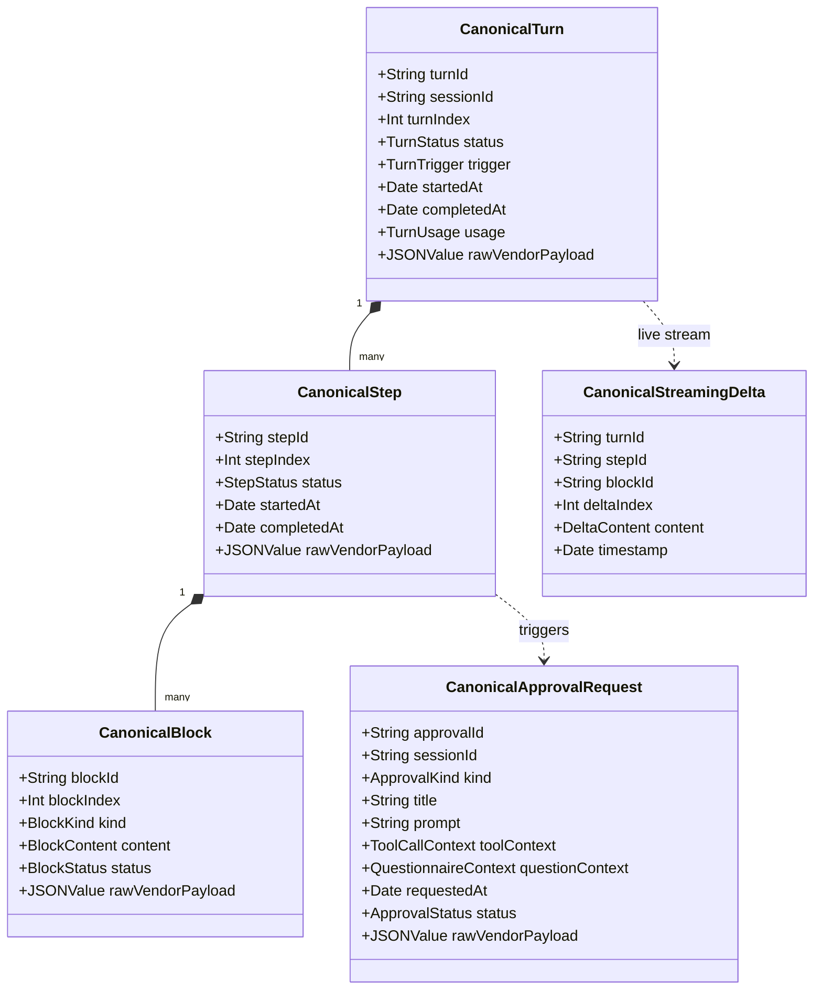

# Pharos Canonical Message & Event Model

---
summary: Specification of the Pharos Canonical Message & Event Model. Evaluates dsh web, Codex app-server, Antigravity ACP, and the public Agent Client Protocol (ACP) standard. Recommends a Pharos Superset Canonical Model combining dsh's hierarchical blocks and turn state with ACP's typed content model and lossless rawVendorPayload preservation.
---

## 1. Executive Summary & Design Philosophy

Milestone 3 requires an interactive desktop client (modelled on Grok Bot) that unifies multiple heterogeneous AI coding backends (`dsh`, `Codex`, `agy`) across distributed hosts (`mini`, `Air`) into a single cohesive interface.

Each underlying CLI presents a distinctly shaped communication protocol:
- **`dsh` (web Host 0.2.1-rc.5)** delivers a rich, hierarchical, stream-based presentation model (`turn` -> `step` -> typed `content[]` blocks with distinct `text-delta` vs `reasoning-delta`, explicit `tool/call` and `tool/result` correlation, and structured approval waterfalls).
- **`Codex` (app-server 0.166.0)** models sessions as threads emitting tagged union items (`userMessage`, `agentMessage`, `reasoning`, `commandExecution`, `fileChange`, `mcpToolCall`) with delta streams and active flags (`waitingOnApproval`).
- **`Antigravity` (agy 1.5.1)** operates an ACP stdio JSON-RPC interface emitting `session/update` chunks and step journals (`transcript.jsonl`) recording `USER_INPUT`, `PLANNER_RESPONSE`, `thinking`, `content`, and `tool_calls`.
- **Public `Agent Client Protocol` (ACP)** provides an emerging vendor-neutral specification based on structured content blocks (`text`, `thought`, `tool_call`, `tool_result`) and JSON-RPC lifecycle methods.

Rather than forcing the client UI to handle three separate protocol dialects, Pharos establishes **ONE Canonical Message & Event Model** (`PharosClientKit`). The client UI renders exclusively against this canonical model. Each backend adapter is responsible for bidirectional translation between the vendor wire protocol and the canonical representation.

### Core Architectural Invariants:
1. **Lossless Translation with `rawVendorPayload`**: No backend metadata is ever silently dropped. Every canonical message, step, tool call, and approval preserves `rawVendorPayload: [String: JSONValue]` containing the unadulterated wire payload.
2. **Dual-Phase Streaming (Deltas vs Committed Blocks)**: Live interactive turns stream ephemeral token deltas (`textDelta`, `reasoningDelta`, `toolCallDelta`) into active chat bubbles. Upon turn completion, the adapter commits authoritative, durable blocks.
3. **Strict Scope Separation (Sessions vs Threads)**: Per user decision (15:00), the **Canonical Rich Message Model applies EXCLUSIVELY to SESSIONS (1:1 direct chat)**. SESSIONS require granular turns, steps, thinking/reasoning blocks, tool execution cards, streaming deltas, and approval waterfalls. In contrast, **THREADS (Group Chat Roster)** use a **separate, lightweight, plain chat bubble DTO** (`ClientThreadMessage`). In Threads, agents do NOT emit thinking, tool, or step events; they return only their final plain text reply over the mesh mailbox.
4. **Stable Composite Identifiers for Reconnect & Replay**: Because some backends (Codex, agy) lack global sequence numbers, the session model establishes composite keys: `(sessionId, turnId, stepId, blockId)` and optional monotonic sequence `seq` to ensure idempotent deduplication and gap reconciliation.
5. **Thread Visual Presentation (Grok Bot Reference)**: Thread chat views adopt the refined bubble and composer geometry from Grok Bot UI research (`2026-11-05_ui-design.md`) as layout and interaction ideas, while adhering strictly to public-repo IP boundaries (100% Pharos-original Swift code, tokens, and Canvas rendering).

---

## 2. In-Depth Comparative Matrix: dsh vs Codex vs agy vs Public ACP

| Dimension | `dsh` (web Host 0.2.1-rc.5) | `Codex` (app-server 0.166.0) | `Antigravity` (agy 1.5.1) | Public ACP Standard (v1.5) |
|---|---|---|---|---|
| **Top-Level Container** | `Session` (`session/create`, `session/list`) | `Thread` (`thread/start`, `thread/list`) | `Session` / `Conversation` (`session/new`) | `Session` (`session/new`, `session/load`) |
| **Execution Unit** | `Turn` (`turn/start`, `turn/end`) containing discrete `Step`s | `Turn` (`turn/start`, `turn/completed`) containing `ThreadItem`s | `Turn` / `Prompt` (`session/prompt`, `stopReason`) | `Prompt` (`session/prompt`) with turn lifecycle |
| **Message Hierarchy** | `turn` -> `step` -> `assistant/message.content[]` | `turn` -> `items[]` (heterogeneous union) | `step` -> `PLANNER_RESPONSE` (`content`, `thinking`, `tool_calls`) | `prompt` -> `content[]` blocks |
| **Content Blocks** | Explicit typed blocks: `text`, `reasoning`, `tool-call` | Heterogeneous items: `agentMessage`, `reasoning`, `commandExecution`, `fileChange` | Journal fields: `content`, `thinking`, `tool_calls` | Typed blocks: `text`, `thought`, `tool_call`, `tool_result`, `image` |
| **Reasoning / Thinking** | Native `reasoning` block; live `reasoning-delta` stream; durable in content array | `reasoning` item with `summary` and `content`; streamed via `item/reasoning/*Delta` | `thinking` string block in transcript; progress updates via ACP | `thought` block with optional collapsible display metadata |
| **Tool Invocations** | Structured `tool/call` (`callId`, `name`, `arguments`) | Categorized items: `commandExecution` (shell), `fileChange` (patch), `mcpToolCall` | `tool_calls[]` array with `id`, `name`, `input` | `tool_call` block with `call_id`, `name`, `parameters` |
| **Tool Results** | `tool/result` with `isError`, output content, and `meta.cwd` | Embedded in item 终态 (`exitCode`, `aggregatedOutput`, `success`) | Successive transcript step or tool response | `tool_result` block with `call_id`, `content`, `is_error` |
| **Streaming Output** | Multiplexed `assistant-stream`: `start`, `chunk` (`text-delta`, `reasoning-delta`, `tool-call-delta`), `finish`, `end` | Socket notifications: `item/agentMessage/delta`, `item/reasoning/textDelta`, `item/commandExecution/outputDelta` | ACP notifications: `session/update` delivering streaming chunk fragments | Streaming delta notifications updating content blocks by index |
| **Mid-Turn Steering** | Supported: `POST /api/session/prompt` (`mode: "steer"`) | Supported: `turn/steer` or `turn/start` on active turn | Supported: ACP `session/prompt` appends to ongoing turn | Supported: cancellation or follow-up prompt injection |
| **Approvals / Questions** | `$events` stream: `approval/request` and `user-questions/request` waterfalls; answered via `POST /api/$events/result` | In-memory `waitingOnApproval` in `thread/status/changed`; answered via server request callback | `session/request_permission` method; answered via JSON-RPC decision | `session/request_permission` with parameter details and options |
| **Model Selection** | `session/selectModel` (`sessionId, provider, model`); audited in `model/selection` | Graceful restart fallback (`codex resume -m <model>`); no mid-session model hot swap | ACP `session/set_config_option` hot swap from dynamic `configOptions` | Protocol negotiation via `session/set_config_option` |
| **Reconnection & Replay** | Monotonic durable `event.seq`; snapshot baseline + `session/page(throughSeq, beforeSeq)` gap backfill | No sequence numbers; reconcile via `thread/turns/list` and `thread/items/list` | Journal line-by-line replay from `transcript.jsonl` | Session state synchronization via snapshot load |
| **Vendor Metadata** | Rich projections (`Projections.values`); `source.replayState` | `additionalDetails`, `codexErrorInfo`, process IDs | Planner metadata, subagent tree references | Generic vendor metadata dictionary |

---

## 3. Comparative Evaluation & Recommendation

We evaluated three potential architectural strategies for the Pharos Canonical Message Model:

### Option A: Pure `dsh`-Shaped Model
- **Description**: Adopt the internal descriptors and wire schemas of `dsh web` 0.2.1-rc.5 (`assistant/message`, `assistant-stream`, `cordis` session events, `RemoteJournalStream` records).
- **Pros**:
  - Near-zero impedance mismatch with `dsh`; 100% lossless for dsh sessions.
  - Exceptionally rich presentation hierarchy natively matching modern coding agent UX (distinct reasoning vs text streams, structured tool cards).
- **Cons**:
  - Heavily coupled to Cordis runtime conventions (e.g. JSON-stringified `arguments` in `tool/call`, `interactions=answer` flags, internal `projections` dictionaries).
  - Translating Codex and Antigravity into internal Cordis semantics introduces awkward synthetic event conversions.

### Option B: Pure Public ACP-Shaped Model
- **Description**: Adopt the Agent Client Protocol (ACP) standard ContentBlock schema (`text`, `thought`, `tool_call`, `tool_result`).
- **Pros**:
  - Standards-compliant and vendor-neutral.
  - Matches the ACP architecture used by `agy acp`.
- **Cons**:
  - ACP is fundamentally a protocol for local stdio agent communication; it lacks built-in wire constructs for multi-host mesh replication, delivery receipt lifecycles (`pending` -> `delivered` -> `consumed`), and structured questionnaire waterfalls (`intent: "plan-review"` with radio/checkbox choices).
  - Lacks native representation for specialized tool execution cards like Codex's `commandExecution` (with exit codes and live terminal interactions) and `fileChange` diff views.

### Option C: Pharos Superset Canonical Model (RECOMMENDED)
- **Description**: A thoughtfully designed Swift-native canonical model that **combines the hierarchical presentation strengths of dsh with the clean block typing of ACP and the rich execution semantics of Codex**, augmented with mandatory `rawVendorPayload` preservation.
- **Why Option C is Superior**:
  1. **Near-Lossless dsh Mapping**: Inherits dsh's separation of Turns, Steps, Reasoning, and Text deltas, and directly maps dsh's structured `approval/request` and `user-questions/request` waterfalls.
  2. **First-Class Codex Tool Support**: Native block variants for `terminalCommand` (with live terminal interactions) and `filePatch` (with before/after diffs), matching Codex items while easily accommodating dsh and agy tool calls.
  3. **ACP Alignment**: Adapters for ACP (`agy`) map 1:1 into canonical `thought`, `text`, `toolCall`, and `toolResult` blocks without impedance.
  4. **Guaranteed Extensibility**: By attaching `rawVendorPayload: [String: JSONValue]` to turns, steps, blocks, and approvals, unmapped vendor extensions (e.g., dsh `replayState`, Codex `memoryCitation`, agy `subagentTree`) are preserved in memory and storage, accessible to inspection UI tabs without polluting core chat views.

---

## 4. Pharos Canonical Message & Event Specification

The canonical model is defined within `PharosClientKit` as strongly-typed, `Sendable`, and `Codable` Swift structures.



### 4.1 Schema Definitions

```swift
// MARK: - Turn & Step Hierarchy

public struct CanonicalTurn: Identifiable, Sendable, Codable, Equatable {
    public let id: String                     // e.g. "turn-01a1..."
    public let sessionId: String              // e.g. "session-uuid"
    public let turnIndex: Int                 // 1-based sequential turn number
    public var status: TurnStatus             // inProgress, completed, failed, interrupted
    public let trigger: TurnTrigger           // userPrompt, steerMessage, threadDelivery, scheduledWakeup
    public let startedAt: Date
    public var completedAt: Date?
    public var steps: [CanonicalStep]
    public var usage: CanonicalUsage?
    public var error: CanonicalError?
    public var rawVendorPayload: [String: JSONValue]?
}

public enum TurnStatus: String, Sendable, Codable, Equatable {
    case inProgress
    case completed
    case failed
    case interrupted
}

public struct CanonicalStep: Identifiable, Sendable, Codable, Equatable {
    public let id: String                     // e.g. "step-1"
    public let stepIndex: Int
    public var status: StepStatus             // running, finished, error
    public var blocks: [CanonicalBlock]
    public let startedAt: Date
    public var completedAt: Date?
    public var rawVendorPayload: [String: JSONValue]?
}

// MARK: - Typed Content Blocks

public struct CanonicalBlock: Identifiable, Sendable, Codable, Equatable {
    public let id: String                     // e.g. "blk-01..."
    public let blockIndex: Int
    public var kind: CanonicalBlockKind
    public var status: BlockStatus            // streaming, committed, failed
    public var rawVendorPayload: [String: JSONValue]?
}

public enum CanonicalBlockKind: Sendable, Codable, Equatable {
    case userText(String)
    case assistantText(String)
    case reasoning(thought: String, summary: String?)
    case toolCall(CanonicalToolCall)
    case toolResult(CanonicalToolResult)
    case terminalCommand(CanonicalTerminalCommand)
    case filePatch(CanonicalFilePatch)
    case attachment(CanonicalAttachment)
}

public struct CanonicalToolCall: Sendable, Codable, Equatable {
    public let callId: String
    public let toolName: String
    public let arguments: [String: JSONValue]
    public let rawArguments: String?
}

public struct CanonicalToolResult: Sendable, Codable, Equatable {
    public let callId: String
    public let isError: Bool
    public let output: String
    public let workingDirectory: String?
    public let durationMs: Int?
}

public struct CanonicalTerminalCommand: Sendable, Codable, Equatable {
    public let commandId: String
    public let command: String
    public let workingDirectory: String?
    public var exitCode: Int32?
    public var stdout: String
    public var stderr: String
    public var durationMs: Int?
}

public struct CanonicalFilePatch: Sendable, Codable, Equatable {
    public let patchId: String
    public let filePath: String
    public let kind: PatchKind                // create, modify, delete
    public let diff: String
}

// MARK: - Streaming Deltas

public struct CanonicalStreamingDelta: Sendable, Codable, Equatable {
    public let turnId: String
    public let stepId: String
    public let blockId: String
    public let deltaIndex: Int
    public let payload: DeltaPayload
    public let timestamp: Date
}

public enum DeltaPayload: Sendable, Codable, Equatable {
    case textDelta(String)
    case reasoningDelta(String)
    case toolCallDelta(argumentsChunk: String)
    case terminalOutputDelta(String)
}

// MARK: - Interactive Approvals & Questionnaires

public struct CanonicalApprovalRequest: Identifiable, Sendable, Codable, Equatable {
    public let id: String                     // e.g. "appr-01..."
    public let sessionId: String
    public let title: String
    public let prompt: String
    public let kind: ApprovalKind             // toolPermission, shellCommand, structuredQuestionnaire
    public let toolContext: CanonicalToolCall?
    public let questionnaire: CanonicalQuestionnaire?
    public let requestedAt: Date
    public var status: ApprovalStatus         // pending, approved, rejected, cancelled
    public var rawVendorPayload: [String: JSONValue]?
}

public struct CanonicalQuestionnaire: Sendable, Codable, Equatable {
    public let questions: [CanonicalQuestion]
    public let intent: String?                // e.g. "plan-review"
}

public struct CanonicalQuestion: Identifiable, Sendable, Codable, Equatable {
    public let id: String
    public let header: String?
    public let question: String
    public let multiSelect: Bool
    public let options: [CanonicalQuestionOption]
}

public struct CanonicalQuestionOption: Sendable, Codable, Equatable {
    public let label: String
    public let description: String?
}
```

### 4.2 Thread Message DTO (`ClientThreadMessage`)

Threads represent multi-agent collaborative task rosters where agents and the human operator converse over the durable Pharos Mesh Mailbox.

Per user directive (Added 15:00), **Threads do NOT use the rich hierarchical block model**. In Threads:
- Agents emit **only their final committed plain text reply** upon turn completion.
- There are **no intermediate thinking/reasoning blocks, no tool execution steps, and no token-level streaming deltas**.
- Messages are represented by a clean, lightweight DTO:

```swift
// MARK: - Thread Message DTO (Plain Chat Bubbles)

public struct ClientThreadMessage: Identifiable, Sendable, Codable, Equatable {
    public let id: String                     // e.g. "thmsg-01..."
    public let threadId: String               // e.g. "th-collab-01"
    public let senderId: String               // memberID or "human"
    public let senderName: String             // e.g. "Pai", "Codex-1", "DSH-Mini"
    public let senderType: SenderType         // .human, .agent
    public let avatarSeed: UInt64             // deterministic avatar seed
    public let text: String                   // final completed message text
    public let timestamp: Date
    public var status: ThreadMessageStatus    // pending, delivered, consumed, completed
    public var receipts: [ClientDeliveryReceipt]
    public var attachments: [ThreadAttachment]?
}

public enum SenderType: String, Sendable, Codable, Equatable {
    case human
    case agent
}

public struct ClientDeliveryReceipt: Sendable, Codable, Equatable {
    public let recipientMemberName: String
    public let stage: ReceiptStage            // accepted, injected, consumed, completed
    public let updatedAt: Date
}

public enum ReceiptStage: String, Sendable, Codable, Equatable {
    case accepted
    case injected
    case consumed
    case completed
}

public struct ThreadAttachment: Sendable, Codable, Equatable {
    public let id: String
    public let name: String
    public let urlString: String
}
```

### 4.3 Thread Chat Window Visual Styling (Grok Bot Reference)

The visual design and interaction ergonomics of the Thread chat window are informed by the Grok Bot 0.78.5 UI reverse-engineering research (`~/brainstorm/collections/design/grok-bot/2026-11-05_ui-design.md`):

1. **Bubble Geometry & Alignment**:
   - **Clamping**: Max bubble width is clamped to `min(80%, 560px, 100% - 82px)` to prevent uncomfortably wide text lines on broad displays.
   - **Padding**: 12px horizontal, 7px vertical; 22px line height.
   - **Corner Radius**: 18px continuous base radius.
   - **Consecutive Message Collapse**: Consecutive messages from the same sender collapse the adjacent corner radius to 6px, creating natural visual message groupings.
   - **Alignment & Avatars**: User/human messages align to the right; agent messages align to the left, preceded by a 36px deterministic Canvas avatar.
   - **Bubble Surface**: Subtle background fill with 0.5px hairline stroke (Light: 6% neutral fill; Dark: 4% neutral fill).
2. **Expandable Sheet Composer**:
   - Compact height: 44px with 22px corner radius.
   - Expanded state: animates smoothly to 18px corner radius when multiline input is entered (scrollHeight ≥ 39px).
   - Bottom action bar: 46px reserved height housing file attachment, mode toggle, and Send button.
   - Spring dynamics: 300ms linear spring animation for smooth height and radius transitions.
3. **Public Repository IP Boundary**:
   - Layout and interaction ergonomics are adopted purely as architectural and UX guidance.
   - **100% Pharos-original implementation**: Native SwiftUI views, Pharos Canvas avatar generation, system fonts (`-apple-system`), and Pharos semantic design tokens (`pharosChrome`, `pharosElevated`, `pharosSidebar`, `pharosInkPrimary`, `pharosAccent`).
   - Zero third-party SVGs, fonts, or copyrighted token assets.

---

## 5. Per-Backend Translation Mappings & Loss Analysis

Each adapter implements bidirectional conversion between its wire protocol and the canonical types.

### 5.1 DeepSeek Harness (`dsh 0.2.1-rc.5`) Mapping
- **Transport**: Persistent `dsh web` Host via HTTP/WS `/api/remote.mux`.
- **Mapping Fidelity**: **Near-lossless (99% direct 1:1 correspondence)**.

| dsh Wire Entity | Canonical Mapping | Fidelity & Loss Analysis |
|---|---|---|
| `turn/start` / `turn/end` | `CanonicalTurn` (`id = turn.turn`, `status = turn/end.reason.kind`) | **Lossless**. `reason.kind` mapped to `TurnStatus`. Raw reason object preserved in `rawVendorPayload`. |
| `step/start` / `step/end` | `CanonicalStep` (`id = "step-\(step)"`, `status = running/finished`) | **Lossless**. |
| `assistant-stream.frame` (`text-delta`) | `CanonicalStreamingDelta` (`.textDelta(chunk.text)`) | **Lossless**. Real-time incremental typing bubble. |
| `assistant-stream.frame` (`reasoning-delta`) | `CanonicalStreamingDelta` (`.reasoningDelta(chunk.text)`) | **Lossless**. Real-time thinking bubble animation. |
| `assistant/message.content[text]` | `CanonicalBlock.assistantText(content.text)` | **Lossless**. Durable committed message. |
| `assistant/message.content[reasoning]` | `CanonicalBlock.reasoning(thought: content.text, summary: nil)` | **Lossless**. Durable thinking block. |
| `tool/call` + `tool/result` | `CanonicalBlock.toolCall` + `CanonicalBlock.toolResult` | **Minor**: dsh `tool-call.arguments` is JSON-stringified. Canonical parses it into `[String: JSONValue]`, keeping raw string in `rawArguments`. |
| `$events` `approval/request` waterfall | `CanonicalApprovalRequest` (`.toolPermission`) | **Lossless**. Answered via `POST /api/$events/result`. |
| `user-questions/request` waterfall | `CanonicalApprovalRequest` (`.structuredQuestionnaire`) | **Lossless**. `intent: "plan-review"` directly preserved. |
| `model/selection` | Updated `ClientSessionSummary.activeModel` | **Lossless**. |
| `projections.values` | Session metadata (title, model, permissions) | Unmapped projections stored in `ClientSessionSummary.rawVendorPayload`. |

---

### 5.2 OpenAI Codex (`codex-cli 0.166.0`) Mapping
- **Transport**: Shared Daemon via WebSocket-over-UDS (`app-server-control.sock`).
- **Mapping Fidelity**: **High (95% correspondence)**.

| Codex Wire Entity | Canonical Mapping | Fidelity & Loss Analysis |
|---|---|---|
| `turn/started` / `turn/completed` | `CanonicalTurn` (`id = turn.id`, `status = completed/interrupted/failed`) | **Lossless**. Failure errors mapped to `CanonicalError`. |
| `item/started` (`userMessage`) | `CanonicalBlock.userText(item.content[0].text)` | **Lossless**. Multimodal attachments (localImage, audio) mapped to `CanonicalAttachment`. |
| `item/agentMessage/delta` | `CanonicalStreamingDelta` (`.textDelta(delta)`) | **Lossless**. Live typing stream. |
| `item/reasoning/*Delta` | `CanonicalStreamingDelta` (`.reasoningDelta(delta)`) | **Lossless**. Live reasoning stream. |
| `item/completed` (`agentMessage`) | `CanonicalBlock.assistantText(item.text)` | **Lossless**. `phase` (`commentary` vs `final_answer`) preserved in `rawVendorPayload`. |
| `item/completed` (`reasoning`) | `CanonicalBlock.reasoning(thought: item.content, summary: item.summary)` | **Lossless**. |
| `item/completed` (`commandExecution`) | `CanonicalBlock.terminalCommand(...)` | **Lossless**. Maps `command`, `cwd`, `aggregatedOutput`, `exitCode`, and `durationMs` directly. |
| `item/completed` (`fileChange`) | `CanonicalBlock.filePatch(...)` | **Lossless**. Maps path and diff directly. |
| `thread/status/changed` (`waitingOnApproval`) | `CanonicalApprovalRequest` (`.shellCommand` / `.toolPermission`) | **Impedance Gap**: In-memory only; no sequence number. Canonical generates synthetic approval ID and binds single ApprovalBroker lease. |
| `thread/turns/list` (reconnect) | History backfill of `[CanonicalTurn]` | **Lossless**. |

---

### 5.3 Antigravity (`agy 1.5.1`) Mapping
- **Transport**: ACP stdio JSON-RPC child process + `transcript.jsonl` journal.
- **Mapping Fidelity**: **High (90% correspondence)**.

| agy Wire Entity | Canonical Mapping | Fidelity & Loss Analysis |
|---|---|---|
| `session/prompt` (request/response) | `CanonicalTurn` (`status = completed` on prompt completion) | **Lossless**. `stopReason` mapped to turn completion state. |
| `session/update` (content chunk) | `CanonicalStreamingDelta` (`.textDelta` / `.reasoningDelta`) | **Lossless**. Live stream. |
| `transcript.jsonl` (`USER_INPUT`) | `CanonicalBlock.userText(content)` | **Lossless**. |
| `transcript.jsonl` (`PLANNER_RESPONSE`) | `CanonicalBlock.assistantText(content)` + `CanonicalBlock.reasoning(thinking)` | **Lossless**. |
| `transcript.jsonl` (`tool_calls[]`) | `CanonicalBlock.toolCall` | **Minor**: Tool results in agy appear in separate follow-up steps. Adapter correlates them by `tool_call_id`. |
| `session/request_permission` | `CanonicalApprovalRequest` (`.toolPermission`) | **Lossless**. Handled via modal dialog and JSON-RPC response. |
| `presence/<id>.lock` | Session liveness in `ClientSessionSummary` | Stale locks resolved via non-blocking `flock(LOCK_EX | LOCK_NB)` (PIT-AG-02). |

---

## 6. Golden Fixture Testing Strategy

To guarantee zero regression and verify lossless conversion across CLI updates, Pharos implements a dedicated fixture test suite: `Tests/PharosTests/CanonicalMessageMappingTests.swift`:

1. **`dsh` Golden Fixture**:
   - Replays raw wire captures from `~/brainstorm/collections/research/dsh-web/runtime-evidence.md` (multi-turn conversation with streaming text, reasoning deltas, tool calls, and `$events` approval waterfalls).
   - Asserts: exact delta count, correct block reconstruction, 100% preservation of `rawVendorPayload`, and valid `CanonicalApprovalRequest` generation.
2. **`Codex` Golden Fixture**:
   - Replays raw JSON-RPC notification sequences from `~/brainstorm/collections/research/codex/` (`turn/started`, `item/started`, deltas, `commandExecution`, `turn/completed`).
   - Asserts: terminal exit code preservation, diff parsing in `CanonicalFilePatch`, and turn reconciliation.
3. **`Antigravity` Golden Fixture**:
   - Replays ACP `session/update` frames and realistic `transcript.jsonl` records.
   - Asserts: correlation of tool calls and tool results, extraction of `thinking` blocks, and graceful recovery from truncated steps.
